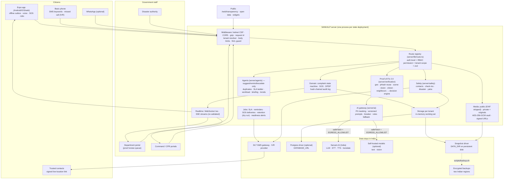

# Architecture — SANKALP AI

One Node.js process per state deployment serves the API, the real-time streams, the HTML portals and the Expo web build. Each Indian state is a **tenant**, selected by host name or the `X-Tenant` header. Every request runs inside its tenant's context, with its own data store, configuration, departments and districts.

## Key flows
**Complaint → proof → closure.**
1. The citizen files a complaint (app, SMS, IVR or WhatsApp).
2. Classification: Sarvam or the rules engine, with an explainable decision record.
3. Duplicate linking.
4. The department works the case and submits proof (camera-only photo plus GPS).
5. Verification signals are computed off-thread, and the decision engine runs: unknown signals never count as a pass.
6. The citizen confirms (app, SMS reply or voice callback).
7. **CLOSED**. Flags send the case to an independent human reviewer, and nothing closes without the citizen ([state machine](MASTER_PROMPT.md#71-complaint-state-machine)).

**SOS.** The trigger is never rate-limited.
- Duplicates are merged.
- The alert goes to the nearest police station(s) and the district control room in real time.
- Trusted contacts get an SMS with a signed link.
- Evidence is encrypted at rest.
- Cancelling needs the PIN or an OTP.
- Offline, the phone's own SMS app opens to the contacts with the last known GPS.

**Data residency.** Every outbound request goes through `server/lib/safeFetch.ts`, and the host must be in `EGRESS_ALLOWLIST`. `npm run egress:audit` fails CI on raw `fetch`, foreign AI SDKs or browser speech recognition. PII is masked before any model call, and a last guard refuses to send text that still looks like a phone number or ID.

## Code map
| Path | What |
|---|---|
| `server/app.ts`, `server/index.ts` | App assembly, boot, graceful shutdown |
| `server/lib/route.ts` | Route registry: the single place auth, RBAC, schemas and pagination are enforced |
| `server/tenancy.ts`, `config/tenants/` | Tenant config (zod-validated at boot), AsyncLocalStorage context |
| `server/storage.ts`, `server/db/` | Per-tenant store; snapshot or Postgres persistence (Drizzle schema, migrations) |
| `server/domain/complaintState.ts` | Explicit state machine (exhaustively tested) |
| `server/verification/` | Proof-of-Fix 2.0 and Real Resolution Rate |
| `server/agents/` | Human-in-the-loop agents (static test: they cannot close or reject) |
| `server/safety/`, `server/routes/{sos,safety,disaster,yatra}.ts` | Personal safety, disaster and yatra modes |
| `server/ai/` | Sovereign AI gateway, PII masking, prompts, rules, eval |
| `server/channels/`, `server/notify/` | SMS/IVR/WhatsApp commands, SMS/voice/push drivers |
| `server/transparency/`, `server/integrations/` | Open data, scorecard, widgets; CPGRAMS/CM-helpline adapters (dry run) |
| `app/`, `components/`, `lib/`, `context/`, `locales/` | Expo app (offline outbox, i18n, voice, safety tools) |
| `server/web/` | HTML portals (JSX compiled on the server; axe-clean) |

## Decisions and limits
See [DECISIONS.md](../DECISIONS.md). The most structural ones:
- D-024: no Docker; Render for pilots, `deploy/install-onprem.sh` for production.
- D-029: one API instance per state, with the working set in memory.
- D-036: machine signals never close or reject a case.
- D-043: no personal data in SMS text.
